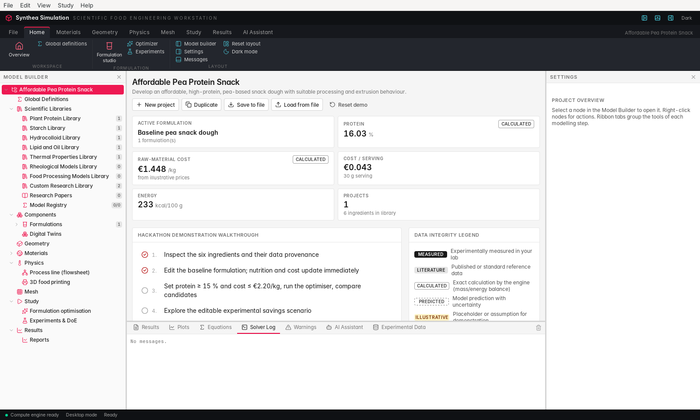
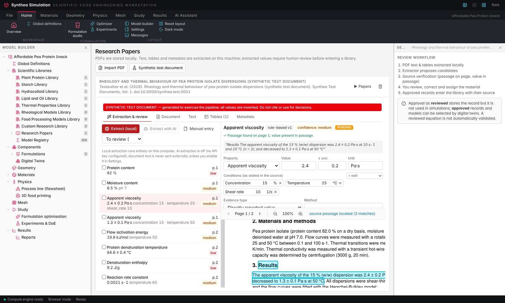
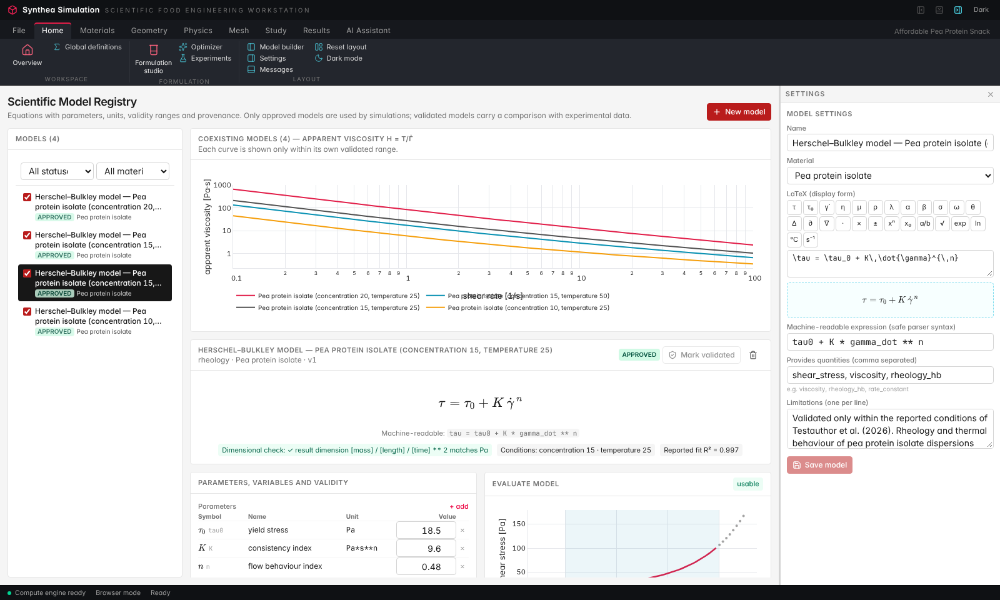
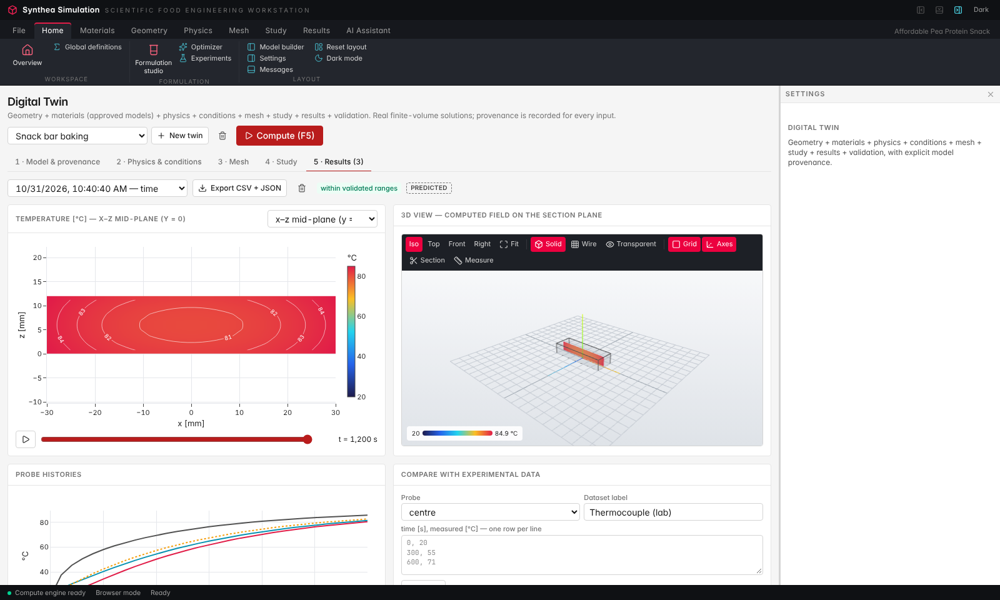
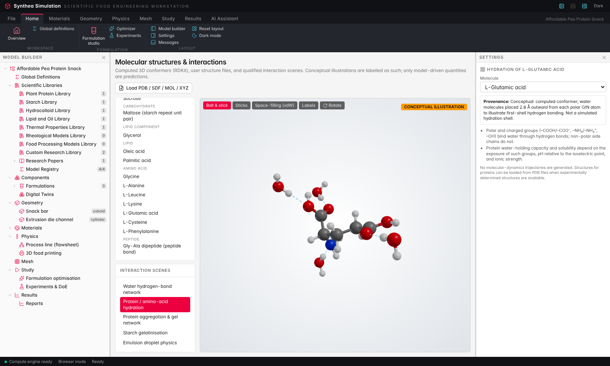

# Synthea Simulation

**A desktop scientific workstation for food formulation and process engineering** — built for the *Hack the Fork*
hackathon.

Synthea Simulation turns research papers into reusable, traceable simulation inputs:

```
Research papers → extracted properties & equations → human review → global scientific libraries
→ model registry (approved, unit-checked, range-limited) → digital twins → virtual experiments → experimental validation
```

Every number used in a simulation can be traced back to an approved library record or model, and from there to the
page and passage of the paper it came from. Values outside a model's validated range are refused unless extrapolation is
explicitly allowed, in which case results are flagged.



## What it does

| Area | Capabilities |
|---|---|
| **Workstation UI** | Ribbon (File · Home · Materials · Geometry · Physics · Mesh · Study · Results · AI Assistant), Model Builder tree with right-click actions, central graphics/view area, Settings inspector, bottom panel (Results · Plots · Equations · Solver Log · Warnings · AI Assistant · Experimental Data). Resizable/hideable panels (Ctrl+1/2/3) with persisted layout, dark mode, keyboard shortcuts (F5 compute, Ctrl+S / Ctrl+Shift+S / Ctrl+O). |
| **Scientific libraries** | Multiple global libraries with folders, archive, export/import; one material record shared by several libraries; condition-aware property records (value/range/text, units normalised with *pint*, uncertainty, conditions, method, source page and passage, evidence type, review status, quality indicator, version history); cross-source comparison with conflict warnings — never silent averaging. |
| **Research papers** | Drag-and-drop PDF import (stored locally), text and table extraction, metadata/DOI/citation detection, page viewer with highlighted source passages. |
| **Extraction & review** | Local rule-based extractor (values, uncertainties, per-value conditions, table-fitted parameters, equation recognition, validity ranges) plus optional Claude extraction after explicit opt-in. Every candidate is verified against the source text and must be reviewed: correct values/conditions, edit LaTeX with a symbol palette, assign the material, approve or reject. |
| **Model registry** | Equations in LaTeX (KaTeX) and machine-readable form, parameters with units, dimensional checks, validity ranges, status workflow (extracted → reviewed → approved → validated → deprecated), evaluation curves, overlay of coexisting models, validation against data (RMSE, R², parity plot). |
| **Geometry** | Points, lines, rectangles, circles, polygons, cuboids, cylinders, spheres, extrusions, STL import/export; transforms, material assignment, analytic and mesh-integrated volume/area; solid/wireframe/transparent views, section plane, measurement, camera presets. |
| **Molecules** | RDKit-computed conformers of food molecules, PDB/SDF/MOL/XYZ loading, ball-and-stick / space-filling views; interaction scenes labelled *conceptual* unless driven by an approved model (e.g. denaturation kinetics) or textbook relations (Laplace pressure, Stokes velocity). |
| **Digital twins** | Finite-volume heat conduction (3-D cuboid, axisymmetric cylinder, sphere), mass diffusion, first-order kinetics on the temperature history, laminar Herschel–Bulkley channel flow. Mesh quality, stationary/time-dependent/sweep/sensitivity studies, animated field maps, 3-D section rendering, probes, flow profiles, experimental comparison, provenance graph. |
| **Formulation & process** (from phase 1) | Formulation Studio, LP optimiser with Pareto front, experiment planning (DoE → GP active learning), process flowsheet, 3-D food-printing toolpaths (shapes from project geometry, nozzle flow from approved rheology models), reports. |

## Run it

### Quickest on Windows (no installer, no Node.js)

1. Install **Python 3.12** from <https://www.python.org/downloads/> and tick **"Add python.exe to PATH"**.
2. Download this branch as a ZIP and unzip it.
3. Double-click **`Start-Synthea.bat`**. The first run installs the scientific packages (a few minutes); the browser
   then opens <http://localhost:8000>. Keep the black window open while you work; close it to stop.

The whole interface is the single file [`standalone/Synthea-Simulation.html`](standalone/Synthea-Simulation.html)
(rebuild with `cd frontend && npm run build:standalone`). The compute engine serves it; opened directly from disk it
shows a start page that waits for the engine and then opens the platform. Everything runs on `127.0.0.1` only.

### Desktop application (Tauri 2)

The desktop app starts its own local compute engine (a packaged Python process) bound to `127.0.0.1` on a random port
with a per-session token, stores data in the per-user application folder, and stops the engine on exit.

* **Windows installer:** the [Desktop build workflow](.github/workflows/desktop.yml) builds NSIS (`.exe`) and MSI
  installers on `windows-latest` (run it from the Actions tab; artifacts are attached to the run).
* **Linux:** `npx tauri build --bundles deb,appimage` in `desktop/` (verified in the build environment).

Build steps (any OS):

```bash
pip install -r backend/requirements.txt pyinstaller
```

```bash
python scripts/build_sidecar.py
```

```bash
cd frontend && npm ci && cd ../desktop && npm ci && npx tauri build
```

Development window: `cd desktop && SYNTHEA_DEV_PYTHON=/path/to/python npx tauri dev` (uses the backend sources).

### Browser (development)

```bash
./scripts/dev.sh
```

Open <http://localhost:5173>. Or run `./scripts/serve.sh` for a single-port build on <http://localhost:8000>.

### Hosting for a team (free)

Free options without payment or credit card — Hugging Face Spaces with automatic backups to a private dataset
(recommended), a laptop with a Cloudflare quick tunnel, or the local network: [`docs/DEPLOY_FREE.md`](docs/DEPLOY_FREE.md).
Set `SYNTHEA_PASSWORD` to protect the site with a shared team password.

## Demonstration

On the **Overview**, press **Build full demonstration**. It imports the bundled **synthetic test document** (every
page is marked as invented test data), runs the local extractor, approves selected values and equations for pea
protein isolate as a reviewer would, creates two digital twins and computes them:

1. *Snack bar heating with protein denaturation* — 3-D conduction with temperature-dependent Choi & Okos properties and
   first-order kinetics from the approved model.
2. *Extrusion die flow — PPI 15 % w/w, 25 °C* — Herschel–Bulkley channel flow using the approved model fitted at exactly
   those conditions; raising the flow rate beyond the validated shear-rate range is refused.

Then explore: the source page of each value (Research Papers → Extraction & review), coexisting models (Model Registry),
the provenance graph (Digital Twin → Model & provenance), the molecular views, and paste your own measurements into
*Compare with experimental data*. The automated check of this walkthrough is `node e2e/demo-walkthrough.mjs`.

## Scientific integrity

* Nothing extracted from a paper enters a library without human review; approval as *reviewed* stores a record but only
  *approved* records and models are used in simulations; *validated* requires an attached comparison with data.
* Values absent from a paper are never invented; candidates whose passage or value cannot be found on the stated page are
  flagged. Conflicting reports coexist with their conditions.
* Solvers are verified (exact plane-wall series solution, energy balance, Newtonian pipe-flow limit) — see
  [`docs/SCIENTIFIC_MODELS.md`](docs/SCIENTIFIC_MODELS.md). No general 3-D FEM/CFD is claimed.
* Ingredient values and prices from phase 1 remain marked *illustrative*; the synthetic test document is marked on every
  page and must never be cited.
* Research PDFs and records stay on the local machine. External AI is used only after explicit opt-in with a
  data-transfer disclosure; API keys stay in the compute engine's environment.

## Architecture

```
desktop/        Tauri 2 shell (Rust): window, native menus, dialogs, compute-engine sidecar lifecycle
frontend/       React 19 + TypeScript + Vite + Tailwind; workspace/ (ribbon, model tree, panels, command bus),
                pages/ (Libraries, Papers, Models, Geometry, Molecules, Twin, …), Three.js/R3F, Plotly, KaTeX
backend/app/    FastAPI compute engine
  knowledge.py, science/catalog.py   libraries, materials, condition-aware records, units (pint)
  papers.py, extraction.py           PDF ingestion (PyMuPDF), extraction and verification
  sci_registry.py                    model registry, dimensional checks, validity, resolver API
  solvers.py, twins.py               finite-volume solvers, digital twins, studies, validation
  molecules.py                       RDKit conformers, structure files, qualified scenes
  db.py                              SQLite document store with schema migrations
scripts/        dev/serve scripts, PyInstaller sidecar build
e2e/            Playwright walkthrough
```

Tests: `cd backend && pytest` (58), `cd frontend && npm test` (12), `node e2e/demo-walkthrough.mjs` (14 checks).
Progress and known limitations: [`docs/DEVELOPMENT_STATUS.md`](docs/DEVELOPMENT_STATUS.md).

| Extraction & review | Model registry |
|---|---|
|  |  |
| **Digital twin results** | **Molecular view** |
|  |  |
