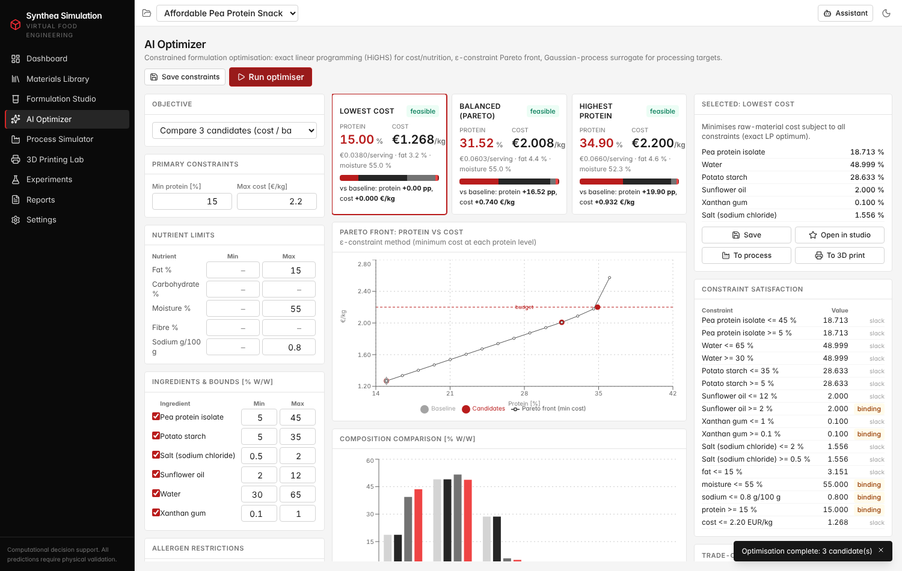
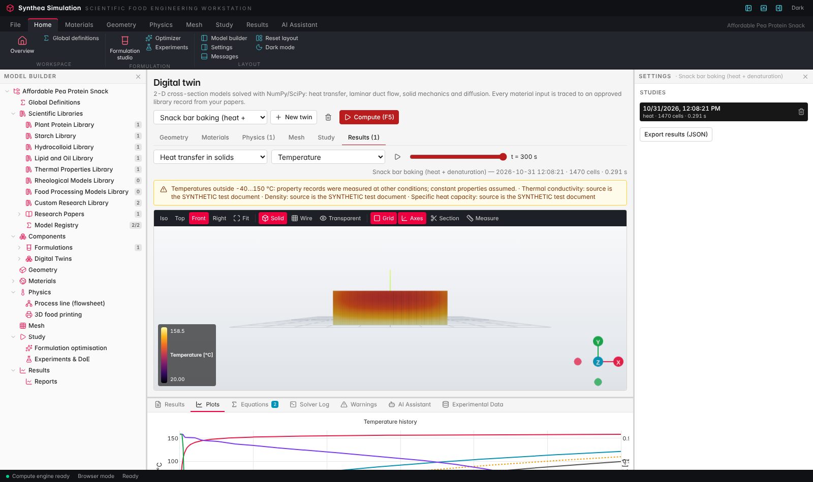
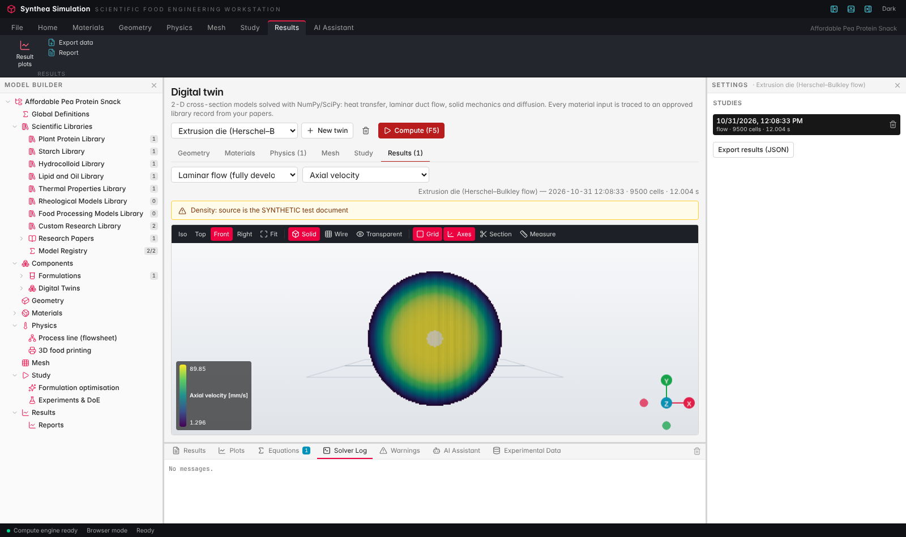
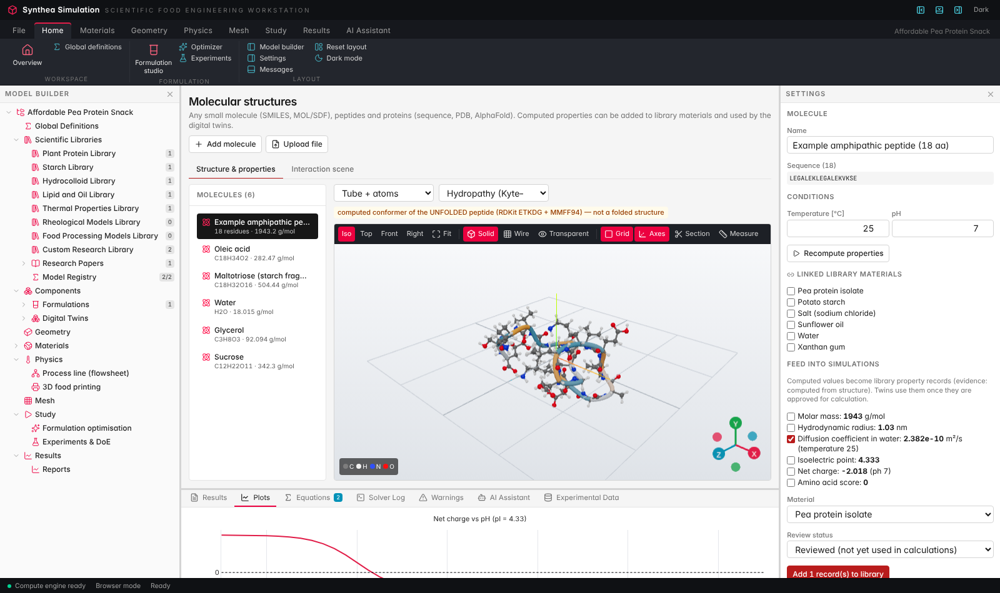
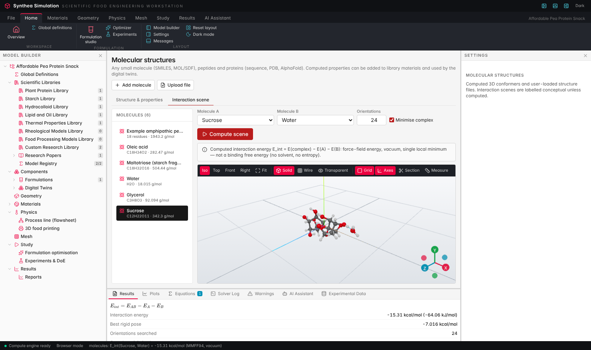
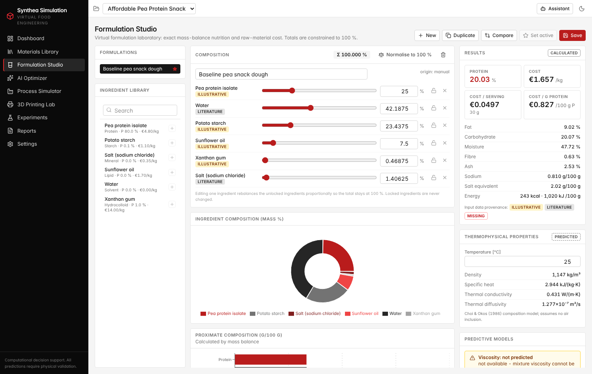
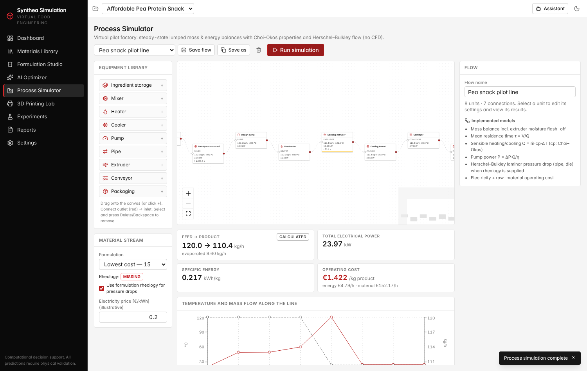
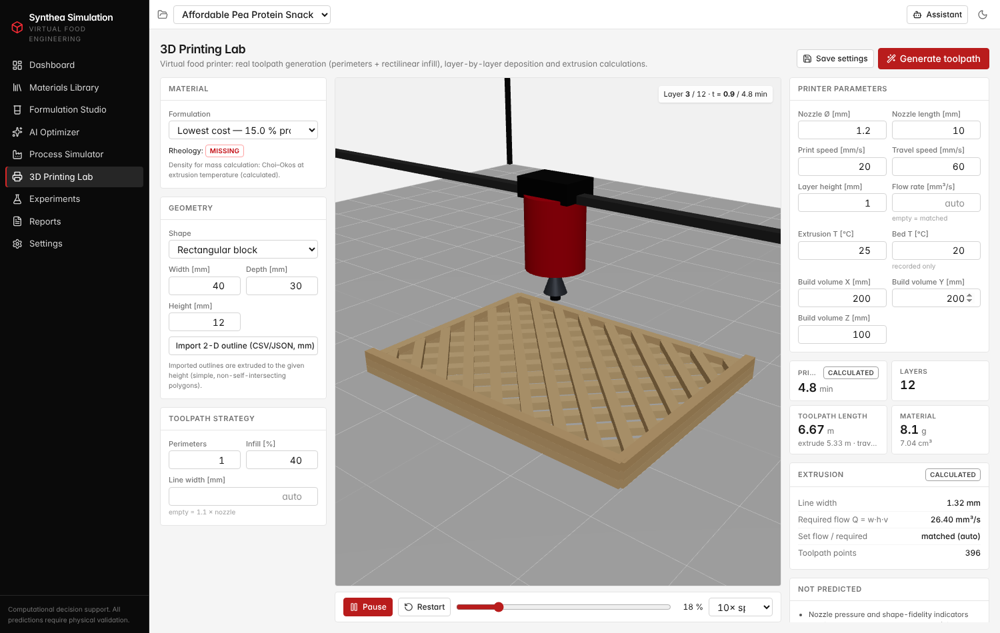
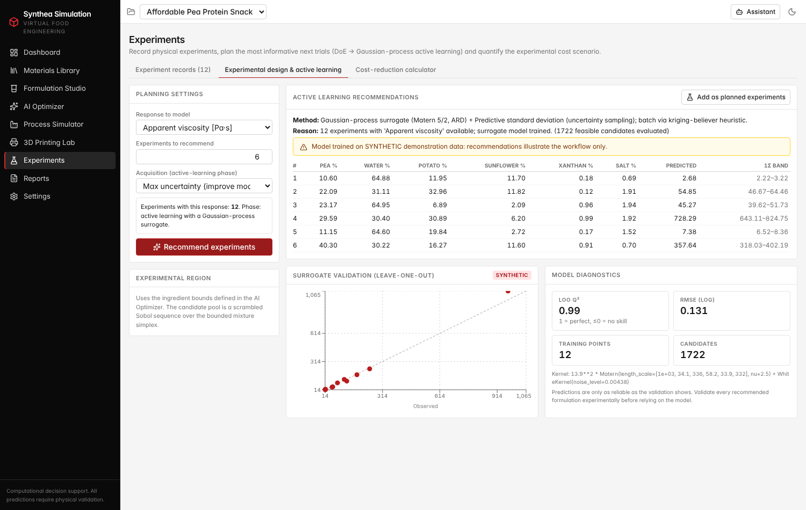

# Synthea Simulation

**AI-assisted virtual food formulation and engineering platform** — built for the *Hack the Fork* hackathon.

Synthea Simulation helps researchers develop affordable alternative-protein foods with fewer physical experiments. It
evaluates formulations virtually, optimises them mathematically, recommends the most informative experiments, and
simulates processing and 3D food printing. Every number comes from a documented computation, and every value is
labelled as *measured*, *literature*, *calculated*, *predicted*, *illustrative*, *synthetic* or *missing*.

> Six ingredients at ten concentration levels already span 10⁶ unconstrained theoretical combinations; processing
> parameters multiply this further. These figures illustrate combinatorial complexity, not the number of experiments
> companies actually run.



## The three modules

| Module | Pages | What it does | Core methods |
|---|---|---|---|
| **Synthea Materials** | Libraries, Papers, Extraction Review, Models, Materials, Formulation, Optimizer, Molecules | Builds the faba bean ingredient knowledge base from uploaded research PDFs (extraction → human review → library records with paper and page; paper summaries), keeps the ingredient table with provenance, and runs the virtual formulation lab and the optimiser (cost / protein / processing constraints, Pareto front, infeasibility diagnosis). Molecular structures feed computed properties into the libraries. | PyMuPDF extraction + rule-based extractor; linear mass balance; EU energy factors; Choi & Okos (1986); LP (HiGHS via SciPy), ε-constraint Pareto front, elastic LP, Monte Carlo; RDKit ETKDG + MMFF94 |
| **Synthea Process** | Process Simulator, Digital Twin | Plant-based sausage line flowsheet with mass and energy balances, residence times, heat duties, pump power, pressure drop and operating cost; 2-D digital twins of the product cross-section (heat + denaturation kinetics, Herschel–Bulkley duct flow, solid mechanics, diffusion) with traceable inputs. | Steady-state lumped flowsheet; HB laminar flow; finite-volume / Q4 finite-element 2-D solvers (NumPy/SciPy) |
| **Synthea Print** | Geometry, 3D Printing Lab | Prototype geometry, toolpath generation (perimeters + ±45° infill), animated printing, print time, material use, required flow and nozzle pressure when rheology is known. | Polygon offset + scan-line fill; bead geometry Q = w·h·v; HB capillary flow |

Shared pages: Dashboard, Global Definitions, Experiments (records, DoE → active learning, cost-reduction calculator),
Reports and Settings. The optimiser is part of Synthea Materials (there is no separate "Optimize" module). The navigation
(routes, model tree, dashboard, breadcrumb) is generated from `frontend/src/lib/modules.ts`.

**Digital twin** — 2-D cross-section models (any shape, editable) solved with NumPy/SciPy: heat transfer
with protein-denaturation kinetics, Herschel–Bulkley duct flow, solid mechanics and diffusion, with 3-D result views.
Every material input comes from approved library records extracted from your papers.
**Molecular structures** — any small molecule (SMILES/MOL/SDF), peptides and proteins (sequence, PDB,
AlphaFold); computed properties (pI, charge, diffusion, amino-acid score, …) feed the libraries and twins; force-field
interaction scenes. See [`docs/DESIGN_DECISIONS_ALI.md`](docs/DESIGN_DECISIONS_ALI.md).

There is also a **scientific assistant** on every page. It works without any external API using a built-in
deterministic explainer. A server-side Claude integration is optional. The assistant never generates numbers; it only
explains numbers produced by the engine. In addition there are **PDF / JSON / CSV reports**, a **scientific model
registry** with live evaluation, a **safe custom-equation evaluator**, project save/load and dark mode.

## Quick start

Requirements: Python ≥ 3.11, Node.js ≥ 20.

```bash
# development (backend on :8000 with reload, frontend on :5173)
./scripts/dev.sh
```

Open <http://localhost:5173>.

```bash
# single-port production-style run (FastAPI serves the built frontend)
./scripts/serve.sh        # then open http://localhost:8000
```

Manual setup:

```bash
cd backend
python3 -m venv .venv && .venv/bin/pip install -r requirements-dev.txt
.venv/bin/uvicorn app.main:app --port 8000
```

```bash
cd frontend
npm ci
npm run dev
```

The SQLite database is created automatically at `backend/data/synthea.db` and seeded with the demo project. Use
**Settings → Data → Reset demo data** to restore it.

### Optional: Claude-powered assistant

Set `ANTHROPIC_API_KEY` in the backend environment before starting it (optionally `SYNTHEA_AI_MODEL`). The key stays on
the server. Without it, everything still works with the built-in explainer.

## Hackathon demo — *Faba Bean Plant-Based Sausage*

| # | Step | Where |
|---|---|---|
| 1 | Open the preloaded project | Dashboard (walkthrough checklist) |
| 2 | Inspect the seven ingredients (faba bean protein isolate FBPI and concentrate FBPC, water, potato starch, sunflower oil, xanthan gum, salt) and their provenance | Materials Library |
| 3–4 | Edit the baseline formulation; nutrition and cost update immediately | Formulation Studio |
| 5–8 | Protein ≥ 12 %, cost ≤ €1.60/kg → **Run optimiser** → compare *Lowest cost / Balanced (Pareto) / Highest protein*; try protein ≥ 60 % to see the infeasibility diagnosis | Materials → Optimizer |
| 9 | Edit the illustrative savings scenario (200 vs 60 experiments, €170, 2 kg, software cost) | Experiments → Cost-reduction calculator |
| 10–11 | **To process** → **Run simulation** | Materials → Optimizer → Process → Process Simulator |
| 12–13 | **To 3D print** → toolpath animates automatically | Materials → Optimizer → Print → 3D Printing Lab |
| 14 | **Generate PDF report** (or JSON / CSV) | Reports |

Expected optimiser results with the illustrative demo data (output of the engine, all prices illustrative): lowest cost
12.0 % protein at €0.814/kg (FBPC only, no FBPI); Pareto knee 19.7 % at €1.262/kg; highest protein 24.4 % at the
€1.60/kg budget. Excluding the "faba" allergen makes the problem infeasible (no other protein source).

The whole demo runs without paid services. Run `node e2e/demo-walkthrough.mjs` (with Playwright available) to check all
14 steps automatically.

## Scientific integrity

* Ingredient values for the commercial ingredients and **all prices are illustrative demonstration values** and are
  labelled as such. Water and NaCl constants are standard reference data. No references, measurements or validations
  are invented.
* Mixture viscosity and texture are **never** computed by weighted averaging. They are reported as *not predicted*
  unless measured flow curves (Herschel–Bulkley τ₀, K, n) are entered for a formulation, or a surrogate is trained on
  recorded experiments.
* Surrogate models report leave-one-out Q², uncertainty bands and extrapolation distance. The synthetic demo-data
  generator is clearly labelled and can be removed in one click.
* The process simulator uses lumped steady-state balances. It is **not** CFD or multiphysics.
* Printing success probability is **not** predicted.
* Cost-saving figures are scenario calculations from user inputs, not measured outcomes.

See [`docs/SCIENTIFIC_MODELS.md`](docs/SCIENTIFIC_MODELS.md) for equations, assumptions and validity ranges.

## Architecture

```
backend/                    FastAPI + NumPy/SciPy/scikit-learn + SQLite
  app/main.py               REST API (+ serves frontend/dist in production)
  app/db.py                 document store (SQLite; JSON documents, portable to PostgreSQL JSONB)
  app/seed.py               demo project and provenance-labelled ingredient data
  app/science/              nutrition, thermal (Choi–Okos), rheology (HB), model registry, safe expression parser
  app/optimize.py           LP optimiser, Pareto front, infeasibility diagnosis, GP-constrained processing optimisation
  app/surrogate.py          Gaussian-process surrogate with LOO validation
  app/experiments.py        DoE, active learning, synthetic demo data, cost scenario
  app/process.py            flowsheet solver
  app/printing.py           toolpath generator and extrusion calculations
  app/assistant.py          deterministic explainer + optional Claude integration
  app/reports.py            PDF report (ReportLab)
  app/twin/                 digital twin: geometry + mesh, 2-D solvers, property resolution, demo twins
  app/jobs.py               background computation jobs (progress, log, cancel)
  app/molecules.py          RDKit conformers, protein calculations, PDB parsing, interaction energies
  app/paper_summary.py      extractive (and optional Claude) paper summaries
  tests/                    pytest (science, optimiser, API)
frontend/                   React 19 + TypeScript + Vite + Tailwind v4
  src/pages/                Dashboard, Materials, Formulation, Optimizer, Process (React Flow),
                            Printing (React Three Fiber), Experiments, Reports, Settings
  src/lib/                  API client, formulation rebalancing (vitest), formatting, hooks
e2e/demo-walkthrough.mjs    Playwright end-to-end check of the 14-step demo
docs/                       development status, scientific models, screenshots
.github/workflows/ci.yml    pytest + typecheck + vitest + build on push / PR
```

## Testing

```bash
cd backend
.venv/bin/pytest -q
```

```bash
cd frontend
npm run typecheck
npm test
npx vite build
```

```bash
node e2e/demo-walkthrough.mjs   # needs the running app and Playwright
node e2e/twin-molecules-smoke.mjs
```

## Screenshots

| Digital twin — heat + denaturation | Digital twin — Herschel–Bulkley die flow |
|---|---|
|  |  |

| Molecular structures | Interaction scene |
|---|---|
|  |  |

| Formulation Studio | Process Simulator |
|---|---|
|  |  |
| **3D Printing Lab** | **Experiments: active learning** |
|  |  |

Development progress is tracked in [`docs/DEVELOPMENT_STATUS.md`](docs/DEVELOPMENT_STATUS.md).
